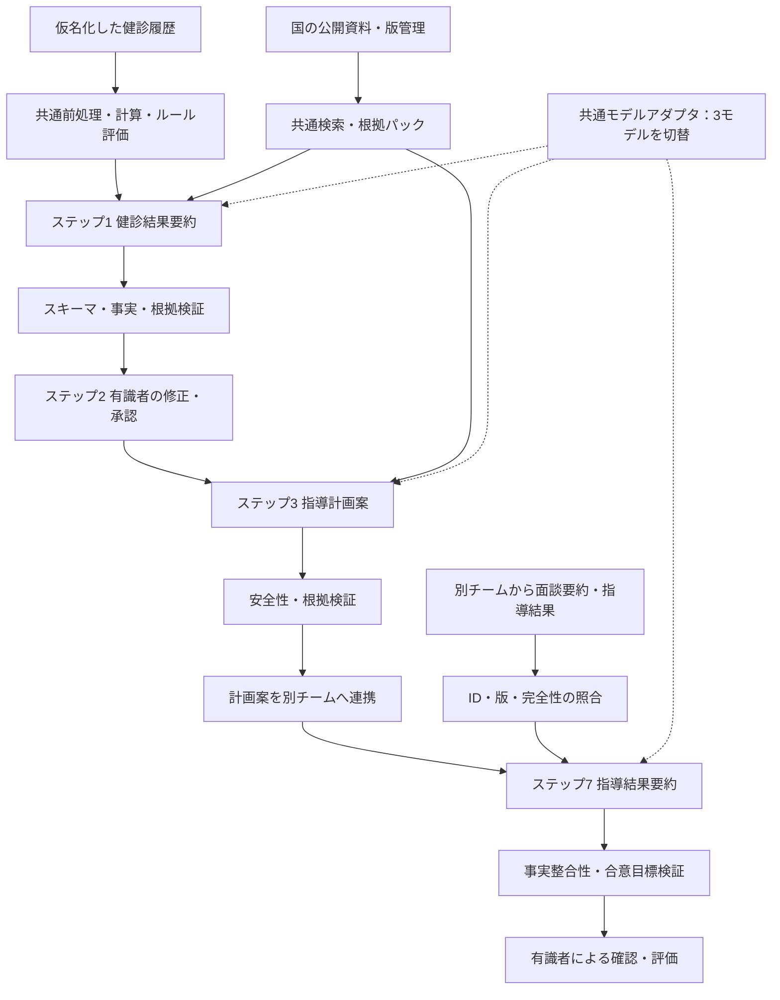

# 特定保健指導業務支援AIエージェント 設計書

作成日：2026年10月15日 / 版：1.0（PoC設計案）  
関連資料：[PoC計画書](02_PoC計画書.md)

## 1. 設計の要旨

健診データの事実整理、指導計画の下書き、面談後の記録統合を担う、業務有識者の確認を前提としたAIエージェントを構築する。自由に業務を実行する方式ではなく、決められた処理順序と承認条件を持つワークフロー型とする。数値計算と制度上の判定は共通の決定的処理、文章化と提案は比較対象のLLMに分担させる。

比較対象はGemma 4 31B、Tsuzumi 30B、Google Distributed Cloud（以下GDC）のGemini。3人が1モデルずつ担当し、前処理・参照資料・画面・評価基盤を共有する。モデル別にシステム全体を三重開発しない。

本PoCの有効性は、正確性、安全性、有識者による修正負担、業務時間、運用費で判定する。100人・過去2～4回の健診データは200～400受診分に相当するが、評価上の独立した単位は100人である。疾病予測精度、将来の健康改善、医療費削減は今回の検証対象にしない。

## 2. 対象範囲と責任境界

| ToBeステップ | 担当・対象範囲 | 入出力・制御 |
|---|---|---|
| 1. 健診結果要約 | 本チーム：AI生成、数値検証 | 健診履歴 → 根拠付きの健診結果要約 |
| 2. 要約レビュー | 業務有識者。本チームは確認・修正・承認機能を提供 | 修正版、承認者、承認日時、版を保存 |
| 3. 指導計画案 | 本チーム：AI生成 | 承認済み要約＋国の公開資料 → 面談用の指導計画案 |
| 4. 面談 | 別チーム：対象外 | 実施方法・録音・面談時間の評価は含めない |
| 5. 面談要約 | 別チーム：対象外 | 音声認識・要約モデルの比較は含めない |
| 6. 指導結果記録 | 別チーム・業務有識者：対象外 | 実際の合意目標・確認事項等を記録 |
| 7. 指導結果要約 | 本チーム：AI生成 | 指導計画案＋連携された面談要約＋指導結果 → 統合要約 |

「指導内容」という連携名称は本設計では「指導結果」に統一する。ステップ7の品質評価・業務利用前の確認も業務有識者が行うが、ステップ6の記録業務を本チームに取り込むものではない。PoC中はAI生成物をそのまま対象者へ送付しない。

## 3. 前提と初月に確定する事項

| 区分 | 設計上の前提／確定事項 |
|---|---|
| 開発体制 | 作業者3人、5か月。業務有識者・別チームは外部協力者として稼働枠を別途確保 |
| 健診形式 | CSV等の構造化データを標準とする。紙・PDFからのOCRは対象外 |
| 項目 | 実際の保有項目を初月に棚卸し。問診、服薬、既往歴、喫煙、生活習慣がない場合は欠損のまま扱う |
| 指導区分 | 既に対象者が選定されていれば提供区分を使用。必要情報がそろう場合のみルールによる参考判定を行う |
| 国の公開データ | 厚生労働省等の指針・手引き・生活習慣に関する公的資料を中心とする。集計統計は参考用途 |
| 基盤 | 3モデルの利用権、実行環境、閉域・接続要件を初月に確認。利用可能性と実測性能は未検証 |
| 開始日 | 未指定のため計画書では開始月をM1と表記 |

追加情報がない対象者について、生活習慣や本人の意欲を推定して事実として記載しない。階層化の要件が不足する場合は「判定不能・要確認」とする。

## 4. 比較モデルと配置方式

| 指定モデル | 比較対象の定義 | 初月に固定する項目 |
|---|---|---|
| Gemma 4 31B | 31Bの指示応答用モデルを指定環境に配置 | 配布元、正確なモデルID、重み版、ライセンス、精度・量子化、推論エンジン、GPU、コンテキスト上限 |
| Tsuzumi 30B | 公式の30B版に対応する「tsuzumi 2」を想定。契約対象と指定の同一性を確認 | 製品・モデルID、提供形態、版、利用条件、API仕様、精度、コンテキスト上限 |
| GDCのGemini | GDC上で実際に利用できるGeminiの1モデル・1版を選定 | connected／air-gappedの別、モデルID、提供段階、ハードウェア、データ経路、契約、推論設定 |

Gemmaの31B版とtsuzumi 2の30B表記は公式資料で確認できる。GDCは実行基盤の名称であり、Geminiの特定モデル名ではない。公開Gemini APIをGDCの代替として無断で比較しない。公式情報と契約・環境内で利用可能な仕様を区別する。[Gemma公式概要](https://ai.google.dev/gemma/docs/core)、[NTT公式資料](https://group.ntt/jp/ir/library/nttis/202511/tsuzumi.html)、[GDC公式ドキュメント](https://docs.cloud.google.com/distributed-cloud/docs)

Gemma・tsuzumiのGPUメモリは重み以外にKVキャッシュ、実行時バッファ、同時実行分が必要になる。BF16の重みだけでも約60～62GB相当という概算を出発点とし、機器を断定せず、代表入力・予定出力長で測定して調達条件を決める。量子化を採用した場合はその構成の品質として評価する。GDCとはハードウェア条件が異なるため、速度の差をモデル能力だけの差と解釈しない。

## 5. 全体アーキテクチャ



| コンポーネント | 責務 |
|---|---|
| データ取込・正規化 | 入力検証、仮名ID照合、日付・単位・項目コード変換 |
| 計算・ルールサービス | 前回差、初回差、BMI等の計算、承認済み制度ルールの適用 |
| 公開資料ストア・検索 | 承認した公的資料の検索。資料版、章・ページ、該当箇所を返す |
| ワークフロー制御 | 承認待ち、生成、差戻し、版更新、別チーム受信待ちを管理 |
| モデルアダプタ | 共通入力を各モデルのAPI形式へ変換。出力を共通スキーマで返す |
| 検証器 | 数値・日付・出典・必須項目・合意目標を照合し、問題時に保留 |
| レビュー画面 | 元データ、AI出力、引用、警告、変更差分を並べて確認 |
| 評価・監査ログ | モデル版、プロンプト版、入力ハッシュ、生成時間、修正履歴、費用を記録 |

LLMにはデータ削除、外部送信、任意コード実行、医療判断の確定権限を与えない。計算・検索の呼出しはワークフロー側で行い、3モデルでツール実装の差が生じない構成とする。追加学習は本PoCの必須範囲に含めず、共通プロンプトと検索拡張生成（RAG）で実現する。

## 6. データ設計

### 6.1 健診履歴の共通形式

| 項目 | 内容・制約 |
|---|---|
| `subject_id` | PoC専用の仮名ID。対応表はデータ管理者が別管理 |
| `exam_id`, `exam_date` | 受診単位の識別子・日付。日付不明時に順序を推測しない |
| 年齢等の属性 | 制度判定・解釈に必要な最小限。氏名・住所・連絡先は原則除外 |
| `measurements[]` | 項目コード、原値、標準化値、単位、検査法・採血条件（あれば）、出典行ID |
| `questionnaire` | 問診回答、取得日、出典。未提供と否定回答を区別 |
| `guidance_category` | 提供元の指導区分、判定日、出典。AIが勝手に変更しない |
| `missing_reason` | 未測定／未提供／不明／検証エラーを区別 |
| `source_version` | 元ファイルの版・ハッシュ、取込日時 |

想定項目は身長、体重、BMI、腹囲、血圧、脂質、血糖・HbA1c、肝機能等。ただし全項目が存在することは仮定しない。空腹時・随時血糖、検査法や単位の異なる値を無条件で時系列比較しない。受診間隔が不均一でも実日付を表示し、単純差を年率変化と誤記しない。

BMI再計算には同一受診時の身長・体重だけを使用し、元記録との不一致は警告する。丸め規則と許容誤差を項目別に固定する。異常値は自動補正せず元値を保持し、入力誤りの可能性と医学的に高い値を分けて扱う。

### 6.2 公開資料の管理

第1優先は制度・業務手順の公的資料、第2優先は生活習慣の説明資料とする。国の集計統計から個人の疾患や目標を推定しない。

| 利用目的 | 参照先と運用 |
|---|---|
| 健診・保健指導の基本ルール | [厚生労働省「標準的な健診・保健指導プログラム（令和6年度版）」](https://www.mhlw.go.jp/stf/seisakunitsuite/bunya/0000194155_00004.html)。訂正・更新も含め採用版を確定 |
| 制度・運用情報 | [厚生労働省「特定健診・特定保健指導について」](https://www.mhlw.go.jp/stf/seisakunitsuite/bunya/0000161103.html)。実施手引きの適用版を確認 |
| 説明・教育用の補助知識 | [厚生労働省 e-ヘルスネット「特定健康診査・特定保健指導」](https://kennet.mhlw.go.jp/information/information/policy/metabolic.html)等から関連資料を選定 |

採用資料に`document_id / title / publisher / URL / edition / effective_date / retrieved_at / hash / section / page`を付与する。公表日と適用期間を区別し、対象年度に対応するルールを使う。PDFの表・脚注は有識者が確認し、判定しきい値は文章検索だけに依存せず承認済みルール表にする。資料が競合する場合は適用条件を確認するまで判断を保留する。

検索は共通のインデックス・検索設定を使用。主比較ではケース・ステップごとの検索結果を事前に固定して全モデルへ同じ順序で渡す。出典のない説明を追加せず、根拠不足は不足として出力する。個人データを公開資料の共有インデックスに投入しない。

## 7. ステップ別エージェントの仕様

### 7.1 ステップ1：健診結果要約エージェント

**入力**：正規化した2～4回の健診履歴、問診等の提供項目、共通計算結果、適用ルールと根拠。

**処理**：受診日順に並べ、最新値・前回値・初回値と差分を整理する。継続課題・変化・確認事項を文章化し、事実と解釈を分離する。受診勧奨等に関わる項目は承認済みルールに基づき有識者の確認対象として提示する。

**出力項目**：

1. 対象者ID、対象受診日、利用データ範囲。
2. 主要指標の時系列表（値、単位、比較可能性、出典）。
3. 数値から確認できる変化・継続課題。
4. 指導上の確認事項、必要情報の不足。
5. 参考判定と適用ルール、要確認の警告。
6. 個々の記述の`evidence_refs`。

検査値だけから病名を断定したり、食生活等の原因を確定したりしない。「異常なし」は情報不足の代用にしない。

### 7.2 ステップ2：レビュー・承認

有識者は原データと要約を照合し、修正・差戻し・承認を行う。警告は確認済み理由とともに記録する。状態は`draft → needs_review → approved`、差戻しは`returned`とする。承認者・日時・版・差分を保存し、`approved`以外からステップ3を開始できない。

承認後に元データや要約が変わった場合、下流の計画案・結果要約を`stale`とし再確認する。過去版を上書きしない。

### 7.3 ステップ3：指導計画案エージェント

**入力**：承認済み健診結果要約、その承認版に紐づく根拠、共通の公開資料パック。未承認の元解釈を再利用しない。

**出力項目**：優先課題（原則3件以内）、課題の根拠、面談時に確認する質問、行動目標の候補、支援方法の候補、確認方法・時期の候補、配慮事項、情報不足、引用。

候補には行動・頻度・実施条件・確認方法を可能な範囲で記載する。ただし本人の希望や身体状況が不明な場合、実行可能性は「面談で確認」とする。運動強度や食事制限等を無条件に確定しない。目標はすべて「提案」であり、合意済み・実施済みと表現しない。薬の開始・中止・変更や診断の指示は行わない。

### 7.4 ステップ7：指導結果要約エージェント

**入力**：面談に使用した指導計画案の版、別チームの面談要約テキスト、業務有識者が記録した指導結果テキスト。

**出力項目**：面談で確認された事実、実際に合意した目標、実施・確認方法、今後の確認事項、計画案からの変更点・不採用項目、未解決事項、情報間の不一致、各記述の出典。

情報の扱いは以下に固定する。

- 合意目標・今後の確認事項は、業務有識者が記録した指導結果を正本とする。
- 面談要約は発言・背景の補足、計画案は面談前の提案の出典とする。
- 計画案にしか存在しない目標を「設定した目標」に移さない。
- 面談要約と指導結果が矛盾したら、両方の記述と出典を示す。正本の内容を保持しても、矛盾を黙って解決せず有識者確認待ちにする。
- 期限や頻度が未記載なら「未記載」とする。新しい助言・目標・受診判断を追加しない。

ステップ7は事実の統合が目的のため、主比較では公開資料検索を行わない。制度説明を追加して入力にない事実と混在させない。

## 8. 別チームとの連携仕様

連携する本文はUTF-8のテキスト。照合に必要なメタデータをJSON等で付ける。転送は認証付きAPIまたはアクセス制御されたファイル領域とし、初期PoCはファイル連携でもよい。

```json
{
  "schema_version": "1.0",
  "subject_id": "P001",
  "encounter_id": "E001",
  "guidance_plan_id": "PLAN001",
  "guidance_plan_version": 2,
  "interview_summary": {
    "document_id": "IS001",
    "version": 1,
    "text": "別チームが作成した面談要約"
  },
  "guidance_result": {
    "document_id": "GR001",
    "version": 1,
    "status": "final",
    "text": "業務有識者が記録した合意目標・確認事項等"
  },
  "recorded_at": "2026-10-15T10:00:00+09:00"
}
```

上記は形式説明用の架空例であり、実測データではない。`final`はステップ6の記録確定状態を表し、本チームがその作業を代行しない。

| 条件 | 受信時の動作 |
|---|---|
| ID・計画案版が一致、両本文あり、指導結果が確定 | 原文を保存して受理、ステップ7へ |
| ID不一致、参照版不明、本文不足、未確定 | 生成せず`waiting_external`または`rejected`、理由を返す |
| 正常受信済みと同じID・版・ハッシュ | 重複として既存結果を返し、二重生成しない |
| 同じID・版なのに本文が異なる | 版衝突として拒否。別チームに新版の発行を依頼 |
| 修正版を受領 | 原文と旧結果を保持し、新版を生成して差分確認 |
| 入力長超過 | 黙って切り捨てず保留。合意した分割仕様で再連携 |

本文内の出典位置は段落IDまたは文字オフセットで保持する。面談要約の誤り自体は別チームの評価範囲だが、入力間の不一致を見つけて表示できるかは本PoCで評価する。

## 9. 出力契約・検証・障害処理

全成果物はJSONの構造化データを正本として、同じデータから日本語Markdownを生成する。

共通ヘッダーは`artifact_id / artifact_type / subject_id / version / status / input_refs / model_id / model_version / prompt_version / knowledge_version / generated_at`。各事実・解釈・提案には`claim_type`と`evidence_refs`を付ける。欠損は`null`と理由で表し、値を補完しない。LLMの自己申告する確信度は承認基準に用いない。

| 検証 | 実装方針 | 失敗時 |
|---|---|---|
| 形式 | JSONスキーマ、必須項目、許可された状態 | 形式修復は最大1回。初回失敗もログ・評価に含める |
| 数値 | 出典の値・単位・日付・計算結果との照合 | 不一致箇所を表示、要確認。勝手に意味を書換えない |
| 根拠 | 出典IDが存在し、対象者・資料版が一致 | 根拠不明の記述を検出。意味的妥当性は有識者も確認 |
| 合意内容 | ステップ7の目標・期限等を指導結果と照合 | 新規追加・矛盾は要確認 |
| アクセス | 対象者・役割単位で入力取得前に照合 | 拒否し監査記録 |
| 通信・実行 | タイムアウト、OOM、API失敗を共通分類 | 一時通信失敗は最大2回再試行。別モデルへ自動切替しない |

再試行後も失敗した案件は手作業へ戻し、その時間と費用を業務評価に含める。自動検証合格は医学的妥当性の保証ではない。

## 10. 情報管理と安全性

- 健診・面談データは要配慮個人情報を含む前提で扱う。利用目的、提供権限、委託・契約条件、必要な同意等をデータ管理者が確認してから実データを投入する。仮名化を匿名化と同一視しない。
- PoC内では最小限の属性のみを使用し、ID対応表をモデル環境から分離する。自由記述の氏名・勤務先等も取込時に確認する。
- 保存・通信を暗号化し、開発者、業務有識者、管理者の権限を分離する。他対象者の情報を検索・閲覧できない制御を設ける。
- モデル提供者の学習利用、入力保持、サポート時のアクセス、テレメトリ送信先を確認する。GDCであることだけを理由に外部送信がないと判断しない。
- 入力本文・公開資料に含まれる命令を実行しない。データ部分を命令と分離し、許可した資料以外への検索・送信を禁止する。
- 通常ログには健診値や本文を記録せずID・版・ハッシュを記録する。評価用の原出力は別の制限領域に保存する。
- 保存期限案はPoC終了後90日以内。法令・組織規程・契約上必要な保存と区別し、M1で確定する。削除対象には検索キャッシュ、バックアップ、評価用出力も含め、削除記録を残す。

## 11. 設計から評価への対応

| 設計上の要点 | PoCで確かめること |
|---|---|
| 共通計算・元値照合 | 数値転記、単位、時系列の正確性 |
| 根拠付き生成 | 引用の存在だけでなく、その根拠が主張を支えるか |
| 承認済み要約だけを使用 | 未承認・旧版から計画案を生成できないこと |
| 欠損を明示 | 情報不足時に推測を事実化しないこと |
| 提案と合意の区別 | ステップ7で未合意目標を追加しないこと |
| 共通入力とモデル交換 | 同一条件で3モデルの品質を比較できること |
| 人の確認を含む業務 | 修正・差戻しを含めても作業時間が減ること |

判定基準、評価用データ分割、必要な有識者工数、月別実行計画は[PoC計画書](02_PoC計画書.md)に定義する。

## 12. 出典・未確定事項

公式ページの確認日は2026年10月15日。引用リンクは設計の情報源であり、PoC用知識ベースの収集・全内容の検証は未実施。ルールの詳細値、採用文書の訂正状況、実際に使うモデルID、契約条件、価格、環境性能はM1で確認・固定する。

設計上の数値目標と運用上限は本PoC向けの提案であり、公的な認証基準やベンダー保証値ではない。
